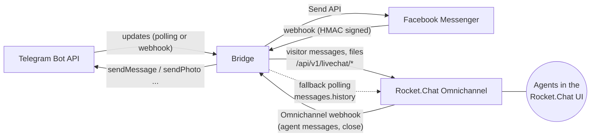
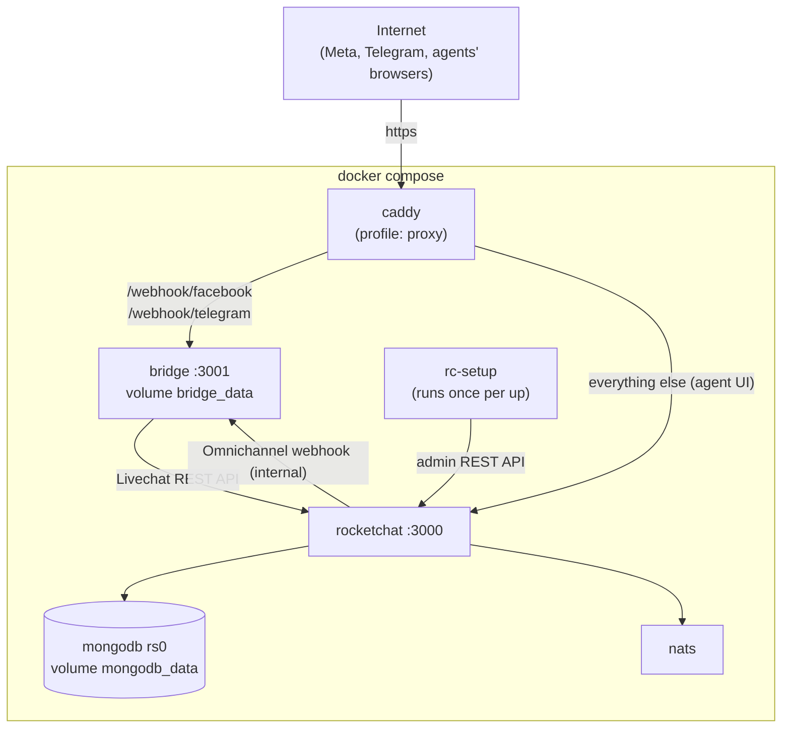

# Rocket.Chat Omnichannel Bridge

A Node.js bridge that connects **Telegram** and **Facebook Messenger** to
**Rocket.Chat Omnichannel** through the Livechat API (`/api/v1/livechat/*`).

What it does:

- Forwards customer messages from Telegram and Messenger into a Rocket.Chat
  Omnichannel room, one visitor and one room per customer.
- Delivers agent replies back to the right platform, pushed by the Rocket.Chat
  Omnichannel webhook (under a second) with polling as a fallback.
- Carries text, emoji, images, files, video, voice, audio, GIFs and static
  stickers in both directions.
- Keeps the visitor/room mapping on disk, so conversations continue after a restart.
- Optional AI auto-reply that uses business facts and documents uploaded for each
  customer, and hands the conversation to a human agent when it cannot answer.
- Runs either with `npm start` next to an existing Rocket.Chat, or as a complete
  Docker Compose stack (Rocket.Chat, MongoDB, NATS, the bridge and optional HTTPS).

## Contents

- [Architecture](#architecture)
- [Requirements](#requirements)
- [Quick start (Node.js)](#quick-start-nodejs)
- [Run the whole stack with Docker Compose](#run-the-whole-stack-with-docker-compose)
- [Configuration](#configuration)
- [Telegram: polling or webhook](#telegram-polling-or-webhook)
- [Facebook Messenger](#facebook-messenger)
- [Rocket.Chat Omnichannel webhook](#rocketchat-omnichannel-webhook)
- [Conversations: AI, closing, failures, edits](#conversations-ai-closing-failures-edits)
- [Text formatting and media](#text-formatting-and-media)
- [Bridge HTTP API](#bridge-http-api)
- [Logging, retries and stored data](#logging-retries-and-stored-data)
- [Testing](#testing)
- [Troubleshooting](#troubleshooting)
- [Known limitations](#known-limitations)
- [Project layout](#project-layout)

## Architecture



- **Customer → agent:** each platform message becomes a visitor message in the
  customer's Livechat room (created on the first message).
- **Agent → customer:** Rocket.Chat pushes each agent message to
  `POST /webhook/rocketchat`. Polling `messages.history` keeps running as a safety
  net and speeds up when the webhook goes quiet. Both paths share one delivery
  queue per customer and a list of delivered message ids, so nothing is sent twice.

## Requirements

- Node.js 20 or newer (CI tests Node 20 and 22; the Docker image uses Node 22).
- A Rocket.Chat server with Omnichannel enabled, plus an agent account or a
  Personal Access Token. Not needed with Docker Compose, which creates both.
- A Telegram bot token (from BotFather) if you use Telegram.
- A Facebook Page, a Meta app and a Page Access Token if you use Messenger.
- An OpenAI-compatible API key if you turn on the AI.

## Quick start (Node.js)

```bash
git clone https://github.com/anhtuan74k5/rc-omnichannel-bridge.git
cd rc-omnichannel-bridge
npm install
cp .env.example .env        # PowerShell: Copy-Item .env.example .env
```

Fill in `.env` (see [Configuration](#configuration)), then:

```bash
npm start        # or: npm run dev   (restarts on file changes)
```

The bridge listens on `PORT` (default `3000`). Rocket.Chat usually already uses
port 3000, so set a different port for the bridge and point it at Rocket.Chat:

```env
PORT=3001
ROCKETCHAT_URL=http://localhost:3000
```

Messenger needs a public HTTPS URL for its webhook. For local development use a
tunnel such as ngrok (see [Facebook Messenger](#facebook-messenger)). Telegram
polling needs no public URL.

## Run the whole stack with Docker Compose

`docker-compose.yml` starts everything with one command: MongoDB (single-node
replica set), NATS, Rocket.Chat 8.9.0, a one-shot `rc-setup` service, the bridge,
and Caddy for HTTPS when you deploy to a server.



### On your computer

1. Copy `.env.example` to `.env` and fill it in. With Docker you need at least:
   - `RC_ADMIN_PASSWORD`: the Rocket.Chat admin created on the first start;
   - `ROCKETCHAT_AGENT_USERNAME` and `ROCKETCHAT_AGENT_PASSWORD`: the account the
     bridge logs in with (`rc-setup` creates it);
   - `ROCKETCHAT_WEBHOOK_SECRET`: any long random string;
   - the Telegram and/or Facebook tokens.

   > With Docker the bridge **always** logs in with the agent username and password.
   > `ROCKETCHAT_AUTH_TOKEN` / `ROCKETCHAT_USER_ID` are ignored there: a token from
   > another Rocket.Chat is not valid in the stack's fresh Rocket.Chat.

2. Start the stack:

   ```bash
   docker compose up -d --build
   docker compose ps               # bridge "healthy", rc-setup "Exited (0)"
   docker compose logs -f bridge
   ```

3. Open `http://localhost:3000`, sign in as an agent and set your status to
   **Available**. Messenger still needs a tunnel (for example ngrok) to port 3001
   while you run on your own computer.

`rc-setup` runs before the bridge on every `docker compose up` and changes nothing
when Rocket.Chat is already set up. It:

- signs in as the admin;
- turns on Omnichannel;
- creates the bridge's agent account and keeps its password in step with `.env`;
- points the Omnichannel webhook at `http://bridge:3001/webhook/rocketchat`.

Rocket.Chat and the bridge talk over the Docker network, so this part needs neither
`host.docker.internal` nor a tunnel. If the admin password in `.env` no longer
matches but the agent account still works, `rc-setup` logs a warning and lets the
bridge start.

> Rocket.Chat refuses to open a new room while **no agent is online**
> (`no-agent-online`); the bridge then tells the customer. Keep at least one agent
> signed in and Available.

### On a server (instead of your computer and a tunnel)

1. Use an Ubuntu server with 2 vCPU and 4 GB RAM, and install Docker. Point a
   domain (A record) at the server and open ports 80 and 443.
2. In `.env`, set `PUBLIC_DOMAIN=chat.example.com` and
   `RC_ROOT_URL=https://chat.example.com`.
3. Run `docker compose --profile proxy up -d --build`. Caddy obtains and renews a
   Let's Encrypt certificate by itself.
4. In Meta for Developers → Messenger → Webhooks, set the Callback URL to
   `https://<PUBLIC_DOMAIN>/webhook/facebook`. Keep the same Verify token.

Only the Facebook and Telegram webhooks and the Rocket.Chat UI are public.
`/health`, `/documents`, `/metrics` and the Rocket.Chat webhook answer `404` from
outside. Check health on the server with `curl http://127.0.0.1:3001/health`.
MongoDB and NATS publish no ports, and Rocket.Chat and the bridge listen on
`127.0.0.1` only (change with `RC_BIND_IP` / `BRIDGE_BIND_IP`).

### Data, updates and removal

| Task | Command |
|---|---|
| Update after `git pull` | `docker compose up -d --build` (data stays in the volumes) |
| Back up Rocket.Chat | `docker compose exec mongodb mongodump --archive > rc-backup.archive` |
| Back up the bridge | copy the `bridge_data` volume (`mapping.json`, Telegram offset, documents) |
| Stop | `docker compose down` |
| Stop and **delete all data** | `docker compose down -v` |

## Configuration

All settings come from environment variables, usually from `.env`.
`.env.example` lists every variable with a comment.

### Rocket.Chat

| Variable | Required | Description |
|---|---|---|
| `ROCKETCHAT_URL` | Yes | Rocket.Chat base URL |
| `ROCKETCHAT_AUTH_TOKEN` | One of the two pairs | Personal Access Token |
| `ROCKETCHAT_USER_ID` | With the token | User id that owns the token |
| `ROCKETCHAT_AGENT_USERNAME` | Other pair | Agent username (required with Docker) |
| `ROCKETCHAT_AGENT_PASSWORD` | Other pair | Agent password (required with Docker) |
| `ROCKETCHAT_DEPARTMENT_ID` | No | Department assigned to new visitors |
| `ROCKETCHAT_POLL_INTERVAL_MS` | No | Polling interval, minimum and default `10000` |
| `ROCKETCHAT_POLL_MAX_CALLS_PER_MINUTE` | No | `messages.history` calls per minute for **all** rooms together, default `8` |
| `ROCKETCHAT_HOT_WINDOW_MS` | No | A room counts as busy for this long after its last message, default `600000` |
| `ROCKETCHAT_MAX_MESSAGE_RETRIES` | No | Attempts for a temporary delivery failure, default `3` |
| `ROCKETCHAT_WEBHOOK_SECRET` | No | Enables `POST /webhook/rocketchat`; must match Rocket.Chat |
| `ROCKETCHAT_WEBHOOK_SILENCE_MS` | No | Webhook silent this long = considered down, default `300000` |
| `ROCKETCHAT_WEBHOOK_FALLBACK_POLL_MS` | No | Polling interval while the webhook is alive, default `60000` |

When both `ROCKETCHAT_AUTH_TOKEN` and `ROCKETCHAT_USER_ID` are set (outside Docker),
the token is used instead of the username and password.

Polling shares one call budget across rooms. Each tick polls only as many rooms as
the budget allows, busy rooms first, and quiet rooms still get their turn. A room the
agent just closed, or one whose push failed, is polled on the next tick. Rocket.Chat's
default API limit is 10 calls per minute, so raise it first (Administration → Settings
→ Rate Limiter → API) if you raise `ROCKETCHAT_POLL_MAX_CALLS_PER_MINUTE`.

### Telegram

| Variable | Required | Description |
|---|---|---|
| `TELEGRAM_BOT_TOKEN` | For Telegram | Token from BotFather |
| `TELEGRAM_POLLING` | No | `true` to receive updates with `getUpdates` |
| `TELEGRAM_POLL_INTERVAL_MS` | No | Polling interval, default `2000` |
| `TELEGRAM_WEBHOOK_SECRET` | Recommended for webhooks | Secret checked on every webhook request |
| `TELEGRAM_WEBHOOK_URL` | For the helper | Public URL of `/webhook/telegram` |
| `TELEGRAM_ALLOWED_CHAT_IDS` | No | Comma-separated chat ids; empty allows every chat |
| `TELEGRAM_MAX_DOCUMENT_BYTES` | No | Document size limit, default 100 MB |
| `TELEGRAM_MAX_MEDIA_BYTES` | No | Photo/video/voice size limit, default 20 MB |
| `TELEGRAM_MAX_UPDATE_RETRIES` | No | Attempts per update before it is skipped, default `3` |
| `TELEGRAM_RENDER_MARKDOWN` | No | Default `true`; `false` sends agent messages as plain text |

With polling off and no `TELEGRAM_WEBHOOK_SECRET`, the bridge logs a startup warning
because webhook requests are not authenticated.

### Facebook Messenger

| Variable | Required | Description |
|---|---|---|
| `FB_PAGE_ACCESS_TOKEN` | For Messenger | Page Access Token |
| `FB_VERIFY_TOKEN` | For Messenger | Token Meta sends when it verifies the webhook |
| `FB_APP_SECRET` | Recommended | App Secret; verifies `X-Hub-Signature-256` |
| `FB_MAX_MEDIA_BYTES` | No | Attachment size limit, default 25 MB (the Messenger limit) |
| `FB_HUMAN_AGENT_TAG` | No | `true` retries late replies with the `HUMAN_AGENT` tag (see below) |
| `FB_PAGE_ID` | No | Not used by the code |

Tokens and secrets are never written to the log.

### AI and documents

| Variable | Default | Description |
|---|---|---|
| `AI_ENABLED` | `false` | Turn on AI auto-replies |
| `AI_API_KEY` | empty | OpenAI-compatible API key |
| `AI_BASE_URL` | `https://api.openai.com/v1` | API base URL |
| `AI_MODEL` | `gpt-4o-mini` | Model name |
| `AI_BUSINESS_CONTEXT` | empty | Business facts the AI may use |
| `AI_HANDOFF_MESSAGE` | see `src/constants/messages.js` | Sent when the AI hands over to an agent |
| `AI_RESUME_AFTER_MINUTES` | `30` | AI stays silent in a room this long after a handoff or an agent reply |
| `AI_TIMEOUT_MS` | `30000` | A slower AI answer is dropped and the message goes to an agent |
| `ADMIN_API_KEY` | empty | Bearer key for `/documents`; empty disables both document routes (`503`) |
| `REQUEST_BODY_LIMIT` | `2mb` | Body limit for `/documents/upload` only |
| `DOCUMENT_CHUNK_SIZE` | `1200` | Document chunk size |
| `DOCUMENT_CHUNK_OVERLAP` | `150` | Overlap between chunks |
| `DOCUMENT_TOP_K` | `4` | Chunks used to answer a question |
| `DOCUMENT_SUMMARY_TOP_K` | `8` | Chunks used for a summary |

The AI only uses `AI_BUSINESS_CONTEXT` and documents uploaded for the same platform
and user. When that is not enough it hands the conversation to an agent instead of
guessing. Documents are matched by keywords, not by meaning.

### Runtime

| Variable | Default | Description |
|---|---|---|
| `PORT` | `3000` | Bridge HTTP port (`3001` inside Docker) |
| `WEBHOOK_BODY_LIMIT` | `1mb` | Body limit for every route except `/documents/upload`; larger bodies get `413` |
| `RATE_LIMIT_PER_MINUTE` | `20` | Messages per customer per minute; extra messages are skipped once with a notice. `0` disables |
| `HTTP_TIMEOUT_MS` | `15000` | Timeout for normal HTTP requests |
| `HTTP_UPLOAD_TIMEOUT_MS` | `120000` | Timeout for media downloads and uploads |
| `MAX_OUTBOUND_MEDIA_BYTES` | 50 MB | Largest Rocket.Chat file the bridge downloads to forward |
| `CONVERSATION_CLOSED_NOTICE` | `true` | Tell the customer when an agent ends the chat |
| `CONVERSATION_CLOSED_MESSAGE` | see `src/constants/messages.js` | Custom text for that notice |
| `MAPPING_FILE` | `./mapping.json` | Where the visitor/room mapping is stored |
| `LOG_LEVEL` | empty | `debug` also logs routine events (Messenger read receipts, delivery reports, echoes) |
| `DEBUG_POLLING` | `false` | Log polling requests |
| `DEBUG_DUMP_PAYLOADS` | `false` | Write selected raw payloads to `debug-dumps/` |
| `TZ` | `Asia/Bangkok` | Process time zone (same offset as Vietnam) |

### Startup checks and the mock server

On start the bridge calls Facebook `/me` and `debug_token`, and Telegram `getMe`. It
logs `Token OK`, or a warning: `Token check FAILED`, `Token expires soon`, or
`Data access window ends soon`. The last two appear when less than 7 days are left.
A failed check only warns; it never stops the bridge.

A Page Access Token made from a long-lived user token never expires (`expires: never`).
Meta still limits *data access* to 90 days after a Page admin last used or granted the
app (`dataAccessUntil` in the log). Before that date, regenerate the Page token.
Telegram bot tokens do not expire.

`FB_GRAPH_BASE_URL` and `TELEGRAM_API_BASE_URL` (optional) change the Graph and Bot
API origins, so a test bridge can talk to the included mock instead:

```bash
node scripts/e2e/mock-platforms.js 4010
```

The mock injects faults through `POST /__fault`, for example
`{"platform":"facebook","fault":"fb-190","count":1}`. Available faults:

- Facebook: `fb-190`, `fb-551`, `fb-10`, `fb-2018278`, `fb-100`, `fb-rate`.
- Telegram: `tg-401`, `tg-403`, `tg-400-chat`, `tg-400-parse`.
- Both: `http-429`, `http-500`, `http-503`, `timeout`.
- Token checks: `ok-token-expiring`, `ok-data-access-expiring`.

Use the mock only with a test bridge (its own port and `.env`), never with the real one.

## Telegram: polling or webhook

### Polling (simplest, no public URL)

```env
TELEGRAM_POLLING=true
TELEGRAM_BOT_TOKEN=<your-token>
```

The bridge calls `getUpdates` on a timer. A failed update is retried up to
`TELEGRAM_MAX_UPDATE_RETRIES` times. The last handled `update_id` is saved next to
`mapping.json` (`*.tgoffset`, tied to the bot token), so a restart does not process
the last message again. While polling is on, `POST /webhook/telegram` answers `404`.

### Webhook

```env
TELEGRAM_POLLING=false
TELEGRAM_WEBHOOK_URL=https://example.com/webhook/telegram
TELEGRAM_WEBHOOK_SECRET=a-long-random-secret
```

Register the webhook with the helper. It sends `secret_token` when configured and
the list of `allowed_updates` the bridge handles:

```bash
npm run tg:set-webhook
```

Requests without the secret, or with a wrong one, get `401` and are not processed.

## Facebook Messenger

Register this callback URL in Meta for Developers (Messenger → Webhooks) and
subscribe the Page to the `messages` field:

```text
GET  https://<domain>/webhook/facebook    (verification)
POST https://<domain>/webhook/facebook    (events)
```

Meta must send `FB_VERIFY_TOKEN` when it verifies the URL, and it only accepts
public HTTPS. For development, use a tunnel with a fixed domain, so the callback
URL never changes. Examples are an ngrok static domain or Cloudflare Tunnel:

```bash
ngrok http --url=<your-name>.ngrok-free.app 3001
```

Replace `3001` with the bridge's `PORT`. `npm run fb:check` checks the Facebook
settings in `.env` without printing any secret.

> While the Meta app is in **Development** mode, only people with a role on the app
> can message the Page. Public use needs App Review for `pages_messaging`.

### Webhook security and ordering

- With `FB_APP_SECRET` set, every `POST /webhook/facebook` must carry a valid
  `X-Hub-Signature-256` (HMAC-SHA256 of the raw body). Requests without one, or
  with a wrong one, get `401`. Without the secret the bridge logs a startup warning.
- The bridge answers `200` straight after the signature check, then works from a
  queue. Meta waits only about 20 seconds, so a slow AI or Rocket.Chat never makes
  Meta resend.
- Messages from the **same customer** are handled one at a time, in order. Different
  customers are handled in parallel.
- A message Meta sends again (same `message.mid`) is skipped, even after a restart.
  The last 100 ids per customer are kept in `mapping.json`.
- On Ctrl+C / `SIGTERM` the bridge waits up to 10 seconds for the queue to finish.

### Late replies (24-hour window)

Messenger only accepts replies within 24 hours of the customer's last message.
After that Meta refuses the reply (code `10`, subcode `2018278`). The bridge does
not retry, and the agent sees a `⚠️ [Bridge]` notice in the room. With
`FB_HUMAN_AGENT_TAG=true` the bridge retries once with the `HUMAN_AGENT` tag, which
Meta allows for 7 days. This only works if the Meta app has the "Human Agent"
permission.

## Rocket.Chat Omnichannel webhook

Rocket.Chat can push every agent message to the bridge instead of waiting for polling.

1. Set `ROCKETCHAT_WEBHOOK_SECRET` in `.env` and restart the bridge. Without it,
   `POST /webhook/rocketchat` answers `503`.
2. In Rocket.Chat (Administration → Omnichannel → Webhooks, also called CRM
   Integration) set:
   - **Webhook URL:** `http://host.docker.internal:<PORT>/webhook/rocketchat` when
     Rocket.Chat runs in Docker and the bridge runs with `npm start`, or
     `http://bridge:3001/webhook/rocketchat` with Docker Compose (`rc-setup` sets it);
   - **Secret Token:** the same value as `ROCKETCHAT_WEBHOOK_SECRET`;
   - turn on **Send Request on Chat Close**, **Visitor Messages** and **Agent Messages**.

Requests are checked with the `X-RocketChat-Livechat-Token` header and answered with
`200` at once. Delivery uses the same path as polling (same error handling, notices
and AI pause). `GET /health` shows the webhook state under `rocketChatWebhook`.

## Conversations: AI, closing, failures, edits

- **AI handoff.** When the AI hands a conversation to an agent, or an agent replies,
  the AI stays silent in that room for `AI_RESUME_AFTER_MINUTES` and announces the
  handoff only once. The customer can type `/bot` to turn the AI back on. If no AI
  key is set, or the AI is off, every message goes straight to the agents.
- **Agent closes the chat.** The customer gets "the conversation has ended" exactly
  once, even when the webhook and polling both report the close. Turn it off with
  `CONVERSATION_CLOSED_NOTICE=false`. The customer's next message opens a **new room**,
  also when Rocket.Chat answers `room-closed`.
- **Delivery failures.** Temporary errors (network, 5xx, rate limits) are retried up
  to `ROCKETCHAT_MAX_MESSAGE_RETRIES` times. Permanent errors stop at once: a blocked
  bot, a closed 24-hour window, or rejected content. When the bridge gives up it
  posts `⚠️ [Bridge] …` in the room so the agent knows. A rejected token (Facebook
  `190`, Telegram `401`) is logged as `[ALERT]` and shown in `/health`.
- **Edited Telegram messages** reach the room as a new message starting with `✏️`
  ("the customer edited the message"), without running the AI. Edited captions are
  ignored.
- **Rate limit.** More than `RATE_LIMIT_PER_MINUTE` messages per minute from one
  customer: the extra messages are skipped and the customer is told once.

## Text formatting and media

### Agent messages to Telegram

Agent messages and file captions are converted from Rocket.Chat Markdown to Telegram
HTML (`parse_mode: "HTML"`):

| Rocket.Chat | Telegram |
|---|---|
| `*bold*` or `**bold**` | **bold** |
| `_italic_` or `__italic__` | _italic_ |
| `~strike~` or `~~strike~~` | ~~strike~~ |
| `` `code` `` | inline code |
| fenced code block (with an optional language) | code block |
| `[label](https://...)` | link (`http`, `https`, `tg` and `mailto` only) |

- Nothing inside code is formatted, so `snake_case_name`, `2 * 3 * 4` and URLs that
  contain `_` stay as they are.
- Invalid or badly nested syntax falls back to plain text, and no message is lost.
  If Telegram still rejects the entities, the same text is sent once more as plain text.
- Only agent messages are formatted. System messages, bridge notices and AI answers
  are sent as written.
- Long messages are split at 4096 characters (captions at 1024). A code fence cut
  in the middle is closed and reopened in the next part.
- `TELEGRAM_RENDER_MARKDOWN=false` turns this off.

### Agent messages to Messenger

Messenger has no formatting, so Markdown symbols are removed. Messages longer than
2000 characters are split, preferably at a line break. Messenger has no captions
either, so text sent with a file arrives as a separate message right after the file.

### Text handling (both platforms)

- Known shortcodes such as `:smile:` and `:thumbsup:` become emoji; unknown ones
  are kept. Code is never converted.
- Telegram text is normalized to Unicode NFC before it goes to Rocket.Chat.
- Splitting works on grapheme clusters, so combined emoji and flags are never cut in half.

### Media

| Direction | Supported |
|---|---|
| Telegram → Rocket.Chat | Photos, documents, video, voice, audio (including MP3), GIF/animation, video notes, static WebP stickers. Contacts, locations and venues are not forwarded: the room gets a note and the customer is told |
| Rocket.Chat → Telegram | Photos, GIFs, video, audio/voice, documents |
| Messenger → Rocket.Chat | Images, video, audio, files, stickers (one image per sticker); locations as a map link |
| Rocket.Chat → Messenger | Images, GIFs (as images), video, audio/voice, files |

- Messenger attachments are downloaded only from Meta's CDN hosts (`fbcdn.net`,
  `fbsbx.com`, `facebook.com`). Any other URL is refused.
- Files without an extension get one from their content (magic bytes), so audio
  from Messenger gets a player in Rocket.Chat.
- Messenger refuses archives (`.zip`, `.rar`, `.7z`). The customer gets a clear
  "this file type is not supported" notice instead of "try again later".
- The Page Access Token travels in the `Authorization` header, never in a URL.
- Files above the size limits are refused and the customer is told.

## Bridge HTTP API

| Method | Path | Purpose |
|---|---|---|
| `GET` | `/health` | Status, active rooms, queue depth, rate-limit counters, webhook state |
| `GET` | `/webhook/facebook` | Facebook webhook verification |
| `POST` | `/webhook/facebook` | Facebook events |
| `POST` | `/webhook/telegram` | Telegram updates (webhook mode) |
| `POST` | `/webhook/rocketchat` | Rocket.Chat Omnichannel events (needs `ROCKETCHAT_WEBHOOK_SECRET`) |
| `POST` | `/documents/upload` | Upload a document for one customer |
| `GET` | `/documents` | List a customer's documents |

`GET /health` returns these fields, and none of them is a secret:

- `status`, `activeRooms`, `facebookQueueDepth`, `uptimeSeconds`;
- `lastAgentPollAt`, `lastTelegramPollAt`;
- `rocketChat429`, `customerRateLimited`;
- `credentialsRejectedAt`, `facebookTokenConfigured` (true or false);
- `rocketChatWebhook`.

Both `/documents` routes need `Authorization: Bearer <ADMIN_API_KEY>`:

```bash
curl -X POST "http://localhost:3001/documents/upload" \
  -H "Content-Type: application/json" \
  -H "Authorization: Bearer <ADMIN_API_KEY>" \
  -d '{"platform":"telegram","platformUserId":"222333444","filename":"faq.md","content":"Opening hours: 8:00-17:00, Monday to Friday."}'
```

Documents are stored per `platform` + `platformUserId`. Supported types: `.txt`,
`.md`, `.csv`, `.tsv`, `.json`, `.jsonl`, `.html`, `.htm`, `.xml`, `.yaml`, `.yml`,
`.log`, `.ini`, `.conf`, `.env`, `.pdf` and `.docx`. Customers can also send a
document in Telegram; it is indexed for the AI automatically.

## Logging, retries and stored data

- HTTP requests share one timeout and retry policy. `GET` requests may retry network
  errors, timeouts, `429` and `5xx`. `POST` requests are not retried by default, so
  messages are never duplicated.
- When Rocket.Chat answers `429`, polling pauses for the time it asks for. Telegram's
  `retry_after` is respected.
- Tokens, passwords, authorization headers and visitor tokens are masked in the log.
  Message text is never logged, only its length.
- Each message gets one timing line:
  `[timing] <platform>:<id> ai=..ms rocketchat=..ms reply=..ms total=..ms`
  (Messenger adds `queue-wait`).
- Customer names come from Telegram (`first_name last_name` or `@username`) or the
  Facebook User Profile API. They fall back to `TG <id>` / `FB <psid>`, and are
  stored in `mapping.json` so they are looked up only once.
- `mapping.json` is written to a temporary file and then renamed, so a crash never
  leaves a half-written file. A damaged file is set aside as `mapping.json.corrupt-*`.
- With `DEBUG_DUMP_PAYLOADS=true`, selected raw payloads go to `debug-dumps/`, with
  tokens removed. That folder is never committed.

## Testing

```bash
npm test         # node:test, about 170 tests
npm run lint     # ESLint; fails only on errors (current warnings: docs/lint-baseline.md)
```

The tests cover:

- secret masking, timeouts and retries;
- Telegram and Messenger media, Markdown conversion, splitting;
- webhook signatures, the per-customer queue and dedupe;
- the polling scheduler, the Rocket.Chat webhook, and closed-room recovery;
- delivery error classification, the 24-hour window and the `HUMAN_AGENT` retry;
- the Telegram offset.

Many of them run against `scripts/e2e/mock-platforms.js`. Results of the last full
run are in [docs/test-results-auto.md](docs/test-results-auto.md).

CI (`.github/workflows/ci.yml`) runs `npm ci`, `npm run lint` and `npm test` on
Node 20 and 22 for every push and pull request. It uses no secrets. Code style
follows `.editorconfig`: UTF-8, LF, two-space indent.

A manual checklist against real Telegram, Messenger and Rocket.Chat is in
[scripts/smoke.md](scripts/smoke.md). It covers text, emoji, images, PDF, video,
voice, MP3, GIF, stickers, large files, restarts and network loss.

## Troubleshooting

| Symptom | Check |
|---|---|
| `fetch failed` when polling Rocket.Chat | Rocket.Chat is running; `ROCKETCHAT_URL` has the right host and port and is reachable from the bridge; the bridge and Rocket.Chat do not share a port; the token or agent password is still valid |
| `[startup] Initial agent login failed` | Wrong agent credentials. With Docker, make sure `ROCKETCHAT_AGENT_USERNAME` / `ROCKETCHAT_AGENT_PASSWORD` are set and look at `docker compose logs rc-setup` |
| Customer is told no agent is available | No agent is online and Available in Rocket.Chat (`no-agent-online`) |
| `/documents` answers `503` | Set `ADMIN_API_KEY` and restart; send `Authorization: Bearer <ADMIN_API_KEY>` |
| Telegram webhook answers `401` | `TELEGRAM_WEBHOOK_SECRET` differs from the secret registered with Telegram |
| Telegram webhook answers `404` | `TELEGRAM_POLLING=true`; the webhook route is off while polling |
| Messenger webhook answers `401` | `FB_APP_SECRET` is not the App Secret of the app that sends the webhook |
| `/webhook/rocketchat` answers `503` or `401` | `ROCKETCHAT_WEBHOOK_SECRET` is empty, or differs from the Secret Token in Rocket.Chat |

## Known limitations

- The Meta app is in Development mode, so only testers can message the Page.
  Public use needs App Review, and `FB_HUMAN_AGENT_TAG` needs the "Human Agent" permission.
- Rocket.Chat opens no room while no agent is online, so the customer is told to
  wait instead of being queued.
- The Telegram Bot API lets bots download files of at most 20 MB, so larger
  customer files are refused even if `TELEGRAM_MAX_DOCUMENT_BYTES` is higher.
- Animated and video stickers are not converted into animations, Telegram contacts
  and locations are not forwarded, and archives cannot be sent to Messenger.
- State lives in `mapping.json`, which is enough for one bridge instance but not
  for several running side by side.
- The AI finds documents by keywords, not by meaning.

## Project layout

```text
index.js                    Entry point (npm start): loads .env, calls start(), re-exports for tests
Dockerfile                  Bridge image (node:22-alpine, non-root, HEALTHCHECK)
docker-compose.yml          MongoDB + NATS + Rocket.Chat + rc-setup + bridge (+ caddy)
deploy/Caddyfile            HTTPS and public routing on a server
src/
  app.js                    Express app, body parsers, error handler
  server.js                 start(): startup checks, polling loops, graceful shutdown
  runtime.js                Shared singletons: queues, rate limiter, scheduler, rcWebhook
  auth.js                   authorizeAdmin (ADMIN_API_KEY)
  routes/                   facebook, telegram, rocketchat, health, documents
  inbound/                  Customer -> Rocket.Chat
    forwardToRocketChat.js    AI auto-reply, rate limit, send to the room
    rocketchatRoom.js         Create or reuse the visitor and room
    mediaPipeline.js          Download -> upload -> notify, shared by both platforms
    telegram.js               Documents, media, unsupported types
    facebook.js               Attachments and the per-customer queue
    pollTelegram.js           Telegram polling loop
  outbound/                 Agent -> customer
    deliverAgentMessages.js   Delivery with retries and dedupe (polling and webhook)
    pollAgentMessages.js      Fallback Rocket.Chat polling loop
    sendReply.js, sendAttachment.js, deliveryNotices.js
  platforms/                External platforms
    telegram.js               Bot API: polling, webhook, text and media
    facebook.js               Graph API: webhook, Send API, HUMAN_AGENT retry
    facebookProfile.js        Customer names from the Graph API
    webhookGuards.js          Turns the Telegram webhook off while polling
  rocketchat/               Rocket.Chat
    rocketchat.js             Livechat API client
    rcWebhook.js              Omnichannel webhook receiver, fallback polling pace
    pollScheduler.js          Fair polling across rooms, urgent rooms first
  core/                     mapping, keyedQueue, rateLimiter, deliveryErrors,
                            customerNames, metrics, textFormat
  lib/                      httpClient, logger, debugDump
  media/                    Download, classify and convert media
  constants/                Configuration, messages, errors
  knowledge/                ai.js, documents.js, liveLookup.js, prompt.md
scripts/
  rc-bootstrap.js           rc-setup: prepares a fresh Rocket.Chat
  e2e/mock-platforms.js     Mock Graph and Telegram APIs with fault injection
  fb-check.js               npm run fb:check (checks the Facebook settings in .env without printing secrets)
  restart-bridge.ps1        Restart one local bridge instance (Windows)
  smoke.md                  Manual test checklist
test/                       node:test suites
docs/                       Test results, lint baseline
```

At run time the bridge keeps `mapping.json` (plus `mapping.json.tgoffset`) and
`data/documents/` in the project root, or in the `bridge_data` volume with Docker.
